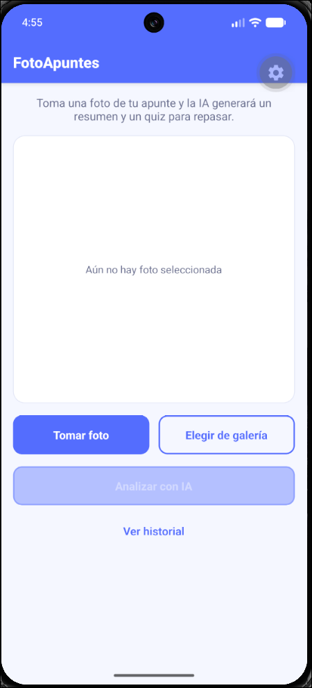
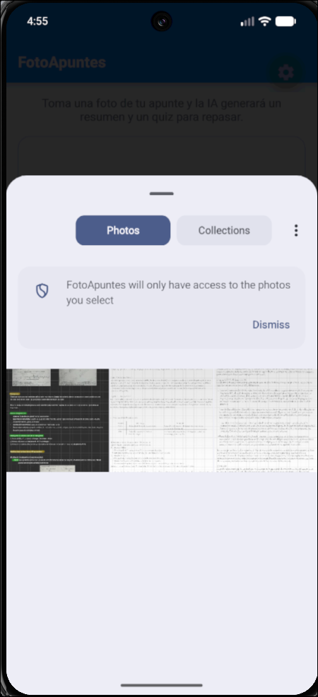
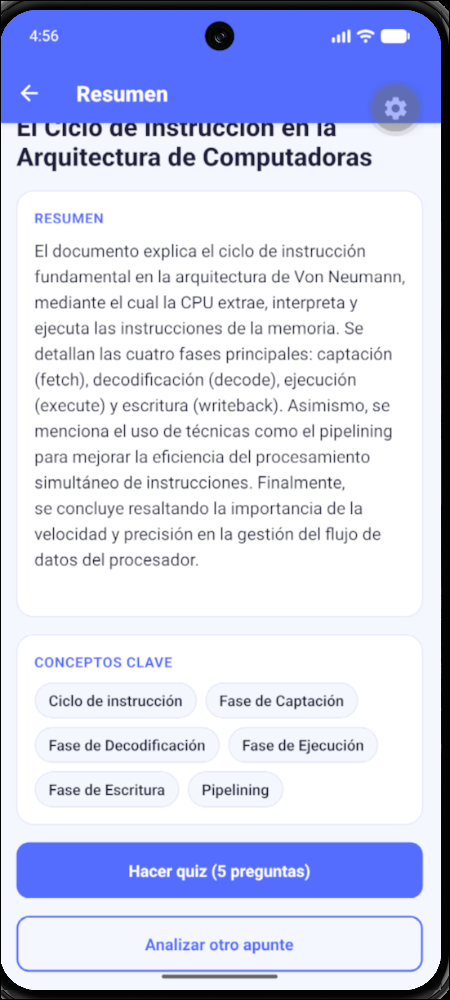
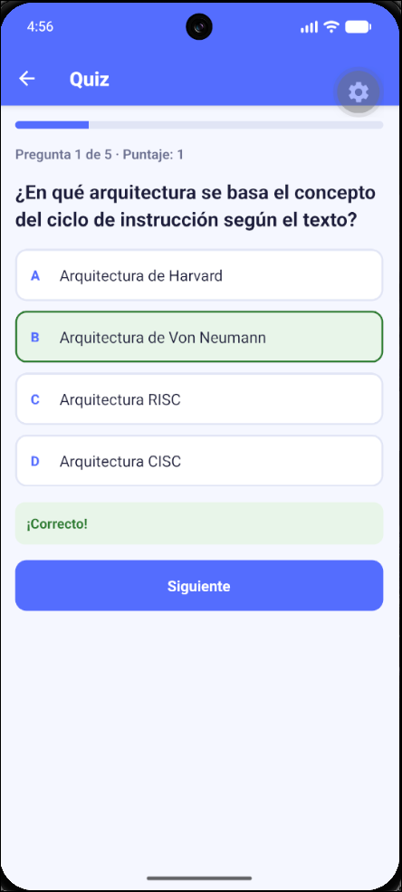
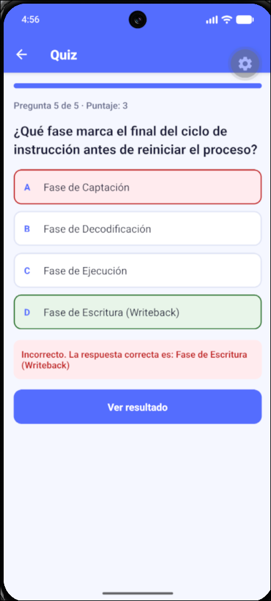

# FotoApuntes

App que permite tomar foto de un apunte (con la cámara o desde la galería), la envía a **Gemini** mediante **Firebase AI Logic** y genera:

- **Resumen**: título, resumen y conceptos clave.
- **Quiz**: 5 preguntas de opción múltiple y una calificación al final del quiz.
- **Historial**: todos los apuntes analizados se guardan localmente con SQLite (incluye el mejor puntaje del quiz).

## Capturas de pantalla

<table>
  <tr>
    <th>Pantalla de captura</th>
    <th>Elegir de galería</th>
    <th>Resumen</th>
  </tr>
  <tr>
    <td></td>
    <td></td>
    <td></td>
  </tr>
  <tr>
    <th>Quiz: respuesta correcta</th>
    <th>Quiz: respuesta incorrecta</th>
    <th></th>
  </tr>
  <tr>
    <td></td>
    <td></td>
    <td></td>
  </tr>
</table>

## Prompt:

```
Eres un tutor que ayuda a estudiantes universitarios a repasar.
Analiza la imagen adjunta, que debería ser la foto de un apunte (...).
1. Si la imagen NO es un apunte o está tan borrosa que no se puede leer, responde con "es_apunte": false (...)
2. Si sí es un apunte (...): título corto, resumen de 3 a 5 oraciones, 3 a 6 conceptos clave
   y EXACTAMENTE 5 preguntas de opción múltiple con 4 opciones y "correcta" = índice (0 a 3).
3. Responde solo con JSON, sin texto adicional ni bloques de código.

Formato:
{ "es_apunte": true, "titulo": "", "resumen": "", "conceptos_clave": [], "preguntas": [ { "pregunta": "", "opciones": [], "correcta": 0 } ] }
```

- **Rol de tutor**: así el modelo enfoca el resumen y las preguntas en el repaso y no en describir la imagen.
- **Campo `es_apunte`**: esto le da al modelo una salida explícita cuando la foto está borrosa o no es un apunte. La app detecta ese caso y muestra un mensaje.
- **Límites concretos** (número de oraciones, de conceptos y exactamente 5 preguntas con 4 opciones): para asegurarse de que las respuestas tengan siempre el mismo tamaño.
- **"correcta" como índice desde 0**: para dejar claro cómo se califica cada pregunta. Además, pedir que varíe la posición evita que la respuesta correcta siempre sea la primera.

Lo probé primero en **Google AI Studio** subiendo la foto de un apunte.

## Generar el development build y ejecutar la app

```bash
npx eas-cli@latest login
npx eas-cli@latest build --profile development --platform android
# Instalar el APK que genera EAS en el emulador o el celular
```

Con el development build ya instalado:

```bash
npx expo start --dev-client
```

Después, abrir la app _FotoApuntes_ en el dispositivo.
